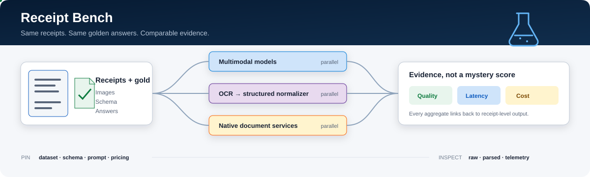

# Receipt Bench

<p align="center">
  
</p>

Receipt Bench runs the same labelled receipts through multiple models and
document services, then compares every result against the same golden answers.
It keeps field accuracy, whole-receipt success, latency, usage, reliability, and
estimated cost separate and traceable.

## What you get

- 22 standalone and assisted Foundry, OCR, Content Understanding, and Document
  Intelligence configurations.
- Built-in SROIE and CORD projects plus immutable labelled-ZIP imports.
- Durable parallel runs with retries, live progress, evidence inspection, and
  downloadable reports.
- One React and FastAPI application backed by Blob, Queue, and Table Storage.

## Run locally

Requires Python 3.12. The default demo is deterministic and needs no Azure
account, `.env`, Docker, or Node.js.

```powershell
py -3.12 -m venv .venv
.\.venv\Scripts\Activate.ps1
python -m pip install -r requirements.lock
python -m pip install --no-deps -e .
receipt-bench demo
```

Open <http://127.0.0.1:8000>. State is retained under `.receipt-bench/`.

## Deploy to Azure

Requires [Azure CLI](https://learn.microsoft.com/cli/azure/install-azure-cli),
[Azure Developer CLI](https://learn.microsoft.com/azure/developer/azure-developer-cli/install-azd),
PowerShell 7, and Python 3.12.

```powershell
az login
azd auth login
pwsh ./scripts/deploy.ps1 -EnvironmentName receipt-bench-yourname
```

The guided command creates or verifies the resource group, Foundry account,
project, minimum-capacity model deployments, and Content Understanding
analyzers. It uses Microsoft Entra ID and managed identity by default, then
previews and applies the Bicep deployment with `azd`.

The full 22-path comparison requires model availability, Marketplace access,
and quota in the selected region. Check without changing Azure first:

```powershell
pwsh ./scripts/deploy.ps1 `
  -EnvironmentName receipt-bench-yourname `
  -ValidateOnly
```

See [Deployment](docs/deployment.md) for options, existing-Foundry reuse, and
the resources created.

## Bring your own data

Import images, one JSON Schema, a prompt, and authoritative answers as a bounded
ZIP. Successful imports are validated, content-addressed, and frozen before
execution. See [Bring your own labelled dataset](docs/byo-dataset.md).

## Important defaults

- Hosted live execution is anonymous and can incur unbounded Azure cost.
- Azure deployment requires subscription-level provider registration and role
  assignment permissions; the script reports the exact administrator action
  when either boundary is missing.
- Uploaded data and run artifacts remain until explicitly deleted.
- Built-in SROIE hosting stays disabled unless each operator supplies their own
  redistribution-rights evidence.
- Raw datasets, credentials, private artifacts, and generated reports are
  excluded from Git.

MIT licensed. Dataset licenses and attribution requirements are documented in
[data/LICENSES.md](data/LICENSES.md).
